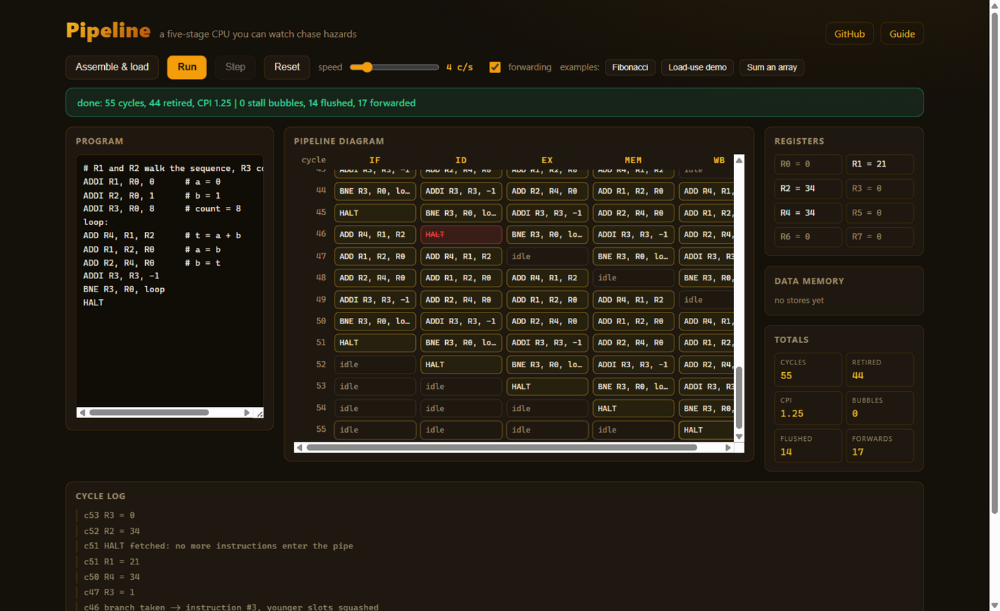
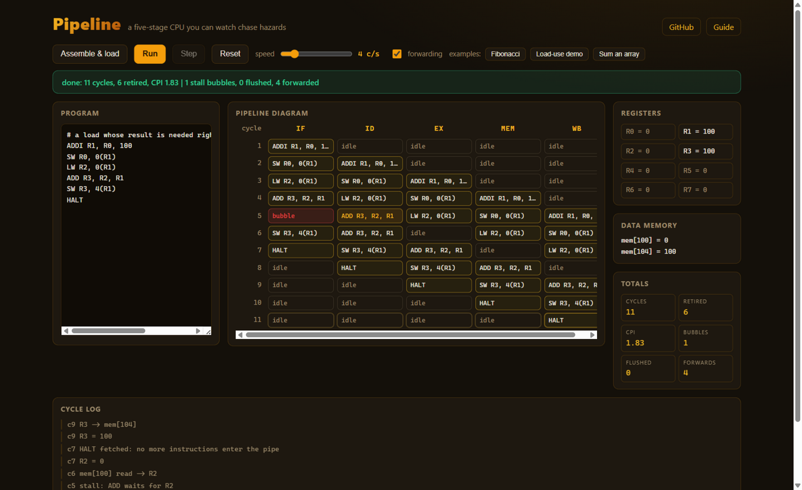

# Pipeline

[](https://github.com/rajpalgelot-tech/cpu-pipeline-simulator/actions/workflows/ci.yml)
[](https://rajpalgelot-tech.github.io/cpu-pipeline-simulator/)

A classic five-stage CPU pipeline (Fetch, Decode, Execute, Memory, Writeback) that runs in your browser, one cycle at a time. Write a tiny assembly program, step through cycles or press Run, and watch data hazards get forwarded around, load-use stalls blow red bubbles into the pipe, and taken branches squash the younger instructions where they stand.



The heart of the project is hazard visibility. This is the classic load-use hazard: the value `LW` loads in Memory cannot reach Execute in time for the instruction right behind it, so the pipeline inserts one bubble no matter how good the forwarding is:



Cycle 5 shows the whole story: the bubble sits in EX, `ADD R3, R2, R1` waits in ID, and the log records "stall: ADD waits for R2".

## Why does this exist?

Pipelining is usually taught with static diagrams. Here the diagram is alive: every cycle is a row you can point at, hazards light up in red and amber as they happen, and the totals (CPI, stall bubbles, flushed instructions, forwarded values) update as the machine works. Turn forwarding off with one click and run the same program again to see exactly what the forwarding hardware is buying you. If you are a student, this gives you a story to tell in interviews that is yours, not the textbook's.

## The instruction set

Eight registers `R0` through `R7` (R0 is hardwired to zero), word-addressed data memory, labels for control flow.

| Instruction | Meaning |
| --- | --- |
| `ADD/SUB/AND/OR/XOR Rd, Ra, Rb` | Rd = Ra op Rb |
| `ADDI Rd, Ra, n` | Rd = Ra + n (n may be negative) |
| `LW Rd, off(Ra)` | Rd = memory[Ra + off] |
| `SW Rs, off(Ra)` | memory[Ra + off] = Rs |
| `BEQ/BNE Ra, Rb, label` | branch if equal / not equal |
| `JMP label` | unconditional jump |
| `NOP`, `HALT` | do nothing / stop fetching |

## What you can do

| Control | What it does |
| --- | --- |
| Assemble & load | Parses the editor text (labels, comments, and all) and loads it into the machine |
| Step | Advances exactly one cycle; every row in the diagram is one cycle |
| Run / Pause | Steps automatically at the speed slider's rate, up to 20 cycles per second |
| Forwarding checkbox | Toggles the forwarding paths; with them off, every dependency stalls until the producer reaches Writeback |
| Examples | Fibonacci, the load-use demo, and a store-then-sum array program |
| Payload editor | Type your own program; assembly errors are reported with line numbers |

## Three experiments worth trying

1. **Break the bypass.** Run the Fibonacci example with forwarding on (55 cycles, CPI 1.25 in the reference run), then uncheck forwarding, press Reset, and run it again. Same program, same result, visibly more cycles. The totals row tells you exactly how many values forwarding rescued.
2. **Find the unavoidable bubble.** Load the "Load-use demo". Even with forwarding on, one red bubble appears: a value loaded from memory is not available until Memory stage, one cycle too late for the instruction right behind it. This is why compilers schedule instructions, and it is visible here in red.
3. **Watch a branch lie to the pipe.** Any taken branch in this design resolves in Execute, which means two younger instruction slots have already been filled on the wrong guess. They show up in the diagram struck through in red, and the "flushed" total counts them.

## How it works

- **Assembler** (`src/cpu/assembler.ts`): two passes. Pass one strips comments, collects labels, and parses operands; pass two resolves branch and jump targets to instruction indexes. Errors carry line numbers.
- **Pipeline** (`src/cpu/pipeline.ts`): four latches (IF/ID, ID/EX, EX/MEM, MEM/WB) shifted once per cycle. Each cycle runs the five stages in reverse order so that Writeback writes the register file in the first half of the cycle and Decode reads it in the second half, which is exactly how the real half-cycle register file trick works.
- **Hazards**: Decode checks the nearest producer for each source register. With forwarding on, only a load consumed immediately in Execute stalls (the load-use hazard); ALU results forward from EX/MEM or MEM/WB. With forwarding off, any producer still in Execute or Memory stalls, which costs two or one cycles depending on distance.
- **Branches**: resolved in Execute with a two slot flush penalty; a taken branch redirects Fetch in the same cycle and re-arms it if a speculative HALT was fetched.
- **Stores** get their value one stage later than everyone else (Memory, not Execute), which is why a store reading a load's result needs no stall at all, the classic Memory to Memory forward.
- **Determinism**: no randomness anywhere, so identical programs always produce identical cycle counts, which is what the tests rely on.

## Honest limitations

- No cache, no memory hierarchy, and memory access always takes one cycle.
- Branch prediction is not modeled; the pipe always predicts "fall through" and always flushes on taken branches. There is no way to add a branch predictor and see its effect (yet).
- Eight registers and a 32-bit-ish arithmetic model keep the display friendly; there is no overflow trapping.
- Real pipelines are wider, deeper, superscalar, and out of order. This one is the honest 1980s baseline.

## Code tour

```
src/
  cpu/
    assembler.ts   two-pass assembler with labels, comments, and line-numbered errors
    pipeline.ts    the five-stage machine: latches, forwarding, stalls, flushes, stats
  ui/
    app.ts         diagram, registers, memory, controls, and the cycle log
    styles.css     the dark amber theme
tests/
  cpu.test.ts      28 deterministic tests: assembler, hazards, stall distances, branches, loops
```

## Development

```bash
npm install
npm run dev        # the machine at http://localhost:5173
npm test           # vitest, all deterministic
npm run build      # typecheck plus a static build in dist/
```

## License

MIT, see [LICENSE](LICENSE).
